# 🌍 Dastaan | Crafting Your Travel Story
> **Stories &bull; Ideas &bull; Emotions** &mdash; A cinematic, editorial travel planning platform that unifies discovery, intelligent budgeting, and personalized day-by-day itineraries into a single cohesive story.

---

## 📖 Table of Contents
- [Overview](#-overview)
- [The Problem We Solve](#-the-problem-we-solve)
- [Technical Architecture & Stack](#-technical-architecture--stack)
- [Directory Structure](#-directory-structure)
- [Key Features & User Journey](#-key-features--user-journey)
- [Design System & Aesthetics](#-design-system--aesthetics)
- [Recommendation & Scoring Algorithm](#-recommendation--scoring-algorithm)
- [Backend Foundation & MongoDB](#-backend-foundation--mongodb)
  - [Environment Configuration](#environment-configuration)
  - [API Endpoints](#api-endpoints)
  - [Mongoose Data Models](#mongoose-data-models)
- [Getting Started & Local Development](#-getting-started--local-development)
  - [1. Prerequisites](#1-prerequisites)
  - [2. Installation](#2-installation)
  - [3. Running Frontend & Backend](#3-running-frontend--backend)
- [Teammate Guide: What Has Happened & Next Steps](#-teammate-guide-what-has-happened--next-steps)
  - [What Has Happened (Phase 1 → Phase 2)](#what-has-happened-phase-1--phase-2)
  - [Where Things Are Located](#where-things-are-located)
  - [Task Breakdown for Team](#task-breakdown-for-team)
- [Roadmap & Future Phases](#-roadmap--future-phases)

---

## 🧭 Overview

**Dastaan** (*Urdu/Persian for "Tales" or "Epics"*) is a modern web application engineered to transform chaotic travel planning into an immersive, editorial storytelling journey. Instead of forcing travelers to juggle dozens of open tabs (maps, booking sites, blogs, budget spreadsheets, and itineraries), Dastaan streamlines the entire travel lifecycle into a personalized narrative tailored to the traveler's budget, timeframe, preferred pace, and personal interests.

---

## 🎯 The Problem We Solve

Traditional travel planning is fragmented:
* 🗺️ **Maps** for checking geographic proximity and routes
* 📝 **Blogs & Social Media** for curated recommendations
* 🏨 **Booking Engines** for accommodation options
* 📊 **Spreadsheets** for budget tracking and estimation
* 🗂️ **Notes Apps** for daily schedules and checklists

**Dastaan unifies this journey into a 3-step paradigm:**
1. **01 &mdash; Tell Us**: Input your destination, duration, budget, pace, and interests.
2. **02 &mdash; We Plan**: Dastaan computes route-optimized timelines, cost breakdowns, and activity sequences.
3. **03 &mdash; You Travel**: Receive a day-by-day travel journal with interactive photo previews and smart replanning capabilities.

---

## 🛠️ Technical Architecture & Stack

Dastaan is built on the **MERN** stack:

```mermaid
flowchart LR
    subgraph Frontend ["React 19 + Vite 6 (Port 3000)"]
      A[Landing Page<br>/] 
      B[Discover Engine<br>/discover]
      C[Trip Configurator<br>/plan]
      D[Itinerary Journal<br>/itinerary]
      E[Auth Portal<br>/auth]
      F[API Client<br>src/services/api.js]
    end

    subgraph Backend ["Node.js + Express (Port 5000)"]
      G[Express App<br>server/src/app.js]
      H[CORS & Error Handlers]
      I[Health Endpoint<br>/api/health]
      J[Data Models<br>User, Trip, SavedDest]
    end

    subgraph Database ["MongoDB Atlas"]
      K[(MongoDB Database)]
    end

    Frontend -->|HTTP Requests| Backend
    Backend -->|Mongoose ODM| Database
```



* **Frontend**: React 19, React Router DOM v7, Vite 6, Modern CSS Custom Properties, Vanilla JS Parallax Physics.
* **Backend**: Node.js v26+, Express 4, Mongoose 8, CORS, Dotenv.
* **Database**: MongoDB (Atlas cloud cluster or local MongoDB instance).
* **Security & Formatting**: Web Crypto API password hashing (client-side prototype), strict CORS origin isolation, sanitized API error responses (zero stack trace / credential leaks).

---

## 📁 Directory Structure

```text
Dastaan/
├── .env.example                      # Frontend environment template
├── .gitignore                        # Git ignore rules (node_modules, .env, dist)
├── index.html                        # Root HTML with Google Fonts & Ogg Medium font
├── package.json                      # Frontend scripts & dependencies
├── vite.config.js                    # Vite configuration (port: 3000)
├── Dastaan-Phase-1/                  # [PROTECTED] Original unmodified Phase 1 static files
├── public/
│   └── images/                       # Landmark photography, logo, and travel imagery
├── server/                           # === EXPRESS BACKEND ===
│   ├── .env.example                  # Backend environment template
│   ├── package.json                  # Express backend dependencies & scripts
│   └── src/
│       ├── config/
│       │   └── db.js                 # Mongoose connection & live status tracker
│       ├── controllers/
│       │   └── healthController.js   # GET /api/health controller
│       ├── middleware/
│       │   ├── errorHandler.js       # Centralized error sanitization
│       │   └── notFound.js           # 404 handler for unmatched /api routes
│       ├── models/
│       │   ├── User.js               # Mongoose User model
│       │   ├── Trip.js               # Mongoose Trip model
│       │   └── SavedDestination.js   # Mongoose SavedDestination model
│       ├── routes/
│       │   ├── api.js                # Master /api router
│       │   └── healthRoutes.js       # /api/health router
│       ├── app.js                    # Express app configuration
│       └── server.js                 # Server entry point (port: 5000)
└── src/                              # === REACT APPLICATION ===
    ├── components/
    │   ├── DevApiStatus.jsx          # Development API status indicator
    │   ├── Footer.jsx                # Multi-column editorial footer
    │   ├── LightboxModal.jsx         # Full-screen place image inspection modal
    │   └── Navbar.jsx                # Responsive glassmorphic header with auth state
    ├── data/
    │   ├── destinations.js           # Catalog of destinations (Kyoto, Jaipur, Manali, etc.)
    │   ├── interests.js              # Travel experiences, icons, and descriptions
    │   └── itineraries.js            # Day-by-day itineraries, place maps, and explanations
    ├── pages/
    │   ├── AuthPage.jsx              # Split-layout login & signup with curtain transition
    │   ├── DiscoverPage.jsx          # Progressive questionnaire, scoring algorithm, results
    │   ├── ItineraryPage.jsx         # Dynamic travel journal, SVG route canvas, budget bar
    │   ├── LandingPage.jsx           # Cinematic parallax storytelling & water cards
    │   ├── NotFoundPage.jsx          # Editorial 404 fallback page
    │   └── TripConfiguratorPage.jsx  # Interactive trip builder (duration, budget, pace)
    ├── services/
    │   └── api.js                    # Reusable API client (fetch wrapper with error handling)
    ├── styles/                       # CSS files migrated directly from Phase 1
    ├── utils/
    │   ├── auth.js                   # Client-side auth helpers & local session management
    │   └── scoring.js                # Weighted Discover recommendation scoring algorithm
    ├── App.jsx                       # Routes & ScrollToTop behavior
    └── main.jsx                      # React DOM entry point
```

---

## ✨ Key Features & User Journey

### 1. Cinematic Landing Experience (`/`)
* **Scroll-Linked Parallax Storytelling**: Smooth scrolling physics with layered split-frame architectural elements.
* **Dynamic Inverted Arch Water-Cards**: 5 chapter cards emerge along a curved trigonometric trajectory (`cos`/`sin`) with 3D tilts.
* **Editorial Problem & Solution Showcase**: Interactive comparison demonstrating how Dastaan unifies fragmented travel tools.
* **Live Replanning Simulation**: Adapts when constraints change (e.g., dynamically adjusting costs from ₹30,000 to ₹19,600).

### 2. Intelligent Destination Discovery (`/discover`)
* **Sticky Chapter Flow**: 4-step progressive questionnaire:
  * `01 TIME` &mdash; Duration (Weekend 2–3 days, 4–6 days, 6–7 days, or 8+ days).
  * `02 BUDGET` &mdash; Budget tiers (Under ₹10K, ₹10K–₹20K, ₹20K–₹40K, ₹40K+) or custom numeric amount.
  * `03 EXPERIENCE` &mdash; Multi-select interests (*Food, Nature, Culture, History, Adventure, Shopping, Art, Nightlife*).
  * `04 PACE` &mdash; Travel rhythm (*Relaxed, Balanced, Packed*).
* **Scroll-Linked Progress Tracking**: Visual fill-bar and chapter highlighting driven by `IntersectionObserver`.
* **Cinematic Search Transition**: Animated progressive loader ("Understanding your journey...", "Finding places that fit...").
* **Asymmetric Editorial Results**: Top recommendations ranked with match percentages (*Great Fit, Strong Fit, Good Fit*), "Why it fits" rationales, sorting (*Best Match, Lowest Budget, Shortest Trip*), and one-click hand-off to trip configurator.

### 3. Interactive Trip Configurator (`/plan`)
* **Destination Selector**: Instant search bar and quick-select chips (*New Delhi, Jaipur, Manali, Kyoto, Mostar, Florence, Istanbul*).
* **Live Visual Feedback**: Crossfading backdrop imagery that changes dynamically based on the selected destination.
* **Step Controls**: Fine-grained duration stepper (-/+ and presets) and numeric budget with instant preset chips.
* **Live Summary & Validation**: Real-time summary card validating user constraints before building the itinerary.

### 4. Dynamic Travel Journal & Itinerary (`/itinerary`)
* **Cinematic Hero Header**: 80vh full-bleed destination imagery with customized taglines dynamically composed from user interests.
* **"Trip at a Glance" Editorial Bar**: Quick breakdown of duration, budget, active interest count, and pace style.
* **Day-by-Day Journal & Timeline**: Sticky day tabs that update alternating editorial cards (*image-left / image-right*) with scheduled times, categorized tags, and rich descriptions.
* **Full-Screen Lightbox Modal**: High-resolution image inspection with place details and category badges upon clicking any activity card.
* **Intelligent Route Sequencing & SVG Canvas**: Visualized topological path diagram showing travel sequence, estimated movement in kilometers, and calculated time saved.
* **Transparent Budget Allocation**: Segmented interactive progress bar with hover tooltips and categorical expense breakdowns (*Accommodation 40%, Food 25%, Transport 15%, Activities 15%, Buffer 5%*).
* **"Built Around You" Panels**: Dynamic explanation cards describing exactly how each chosen interest shaped the itinerary.
* **Actions**: Save Journey (with toast confirmation), Edit Preferences, and Start Over.

### 5. Authentication & Profile Management (`/auth`)
* **Editorial Split Layout**: Photography collage on the left and interactive auth forms on the right.
* **Animated Curtain Transition**: Seamless animated transition between Login and Sign Up views.
* **Password Toggle & Validation**: Eye toggle and password match validation.

---

## 🎨 Design System & Aesthetics

| Token | Hex Value | Role / Usage |
| :--- | :--- | :--- |
| **`--primary`** | `#173B35` | Deep Forest Green (Primary brand tone) |
| **`--gold`** | `#DFBA73` / `#D6B56D` | Royal Gold Accent (Buttons, active states, highlights) |
| **`--paper`** | `#E8DCC7` / `#F4EFE3` | Warm Ivory Paper (Cards, light sections, typography) |
| **`--bg-light`** | `#F7F5EF` | Editorial Light Background (Questionnaires, text sections) |
| **`--ink`** | `#1D2421` | Deep Charcoal Ink (Body copy, high-contrast headings) |
| **`--accent`** | `#C96B4B` / `#C87955` | Terracotta / Clay Accent (Tags, route indicators) |

* **Headings**: `Ogg Medium` & `Cormorant Garamond` (Serif).
* **Interface & Body**: `Inter` / `Satoshi` (Sans-serif).

---

## 🧠 Recommendation & Scoring Algorithm

The Discover engine ranks destinations dynamically against user constraints using a weighted scoring matrix ($S \in [10, 100]$):

$$\text{Total Score} = S_{\text{budget}} + S_{\text{duration}} + S_{\text{interests}} + S_{\text{pace}}$$

| Criterion | Max Weight | Evaluation Logic |
| :--- | :---: | :--- |
| **Budget Fit** | **30%** | **30 pts** if destination budget $\le$ user choice; **15 pts** if within $+25\%$ buffer; **5 pts** otherwise. |
| **Duration Fit** | **25%** | **25 pts** if within preferred day range; **12 pts** if off by $\pm 1$ day; **0 pts** otherwise. |
| **Interests Match** | **30%** | $\text{Score} = \left(\frac{\text{Matching Interests}}{\text{Total Selected Interests}}\right) \times 30\text{ pts}$. |
| **Pace Fit** | **15%** | **15 pts** if destination supports selected travel style; **5 pts** fallback. |

---

## 🔌 Backend Foundation & MongoDB

### Environment Configuration

Create a `.env` file inside `server/` (do **not** commit this file):

```env
PORT=5000
CLIENT_URL=http://localhost:3000
MONGODB_URI=your_mongodb_connection_string
NODE_ENV=development
```

And in the project root:

```env
VITE_API_BASE_URL=http://localhost:5000/api
```

### API Endpoints

| Method | Endpoint | Description |
| :--- | :--- | :--- |
| `GET` | `/` | API status and root info |
| `GET` | `/api/health` | Health check reporting uptime and MongoDB connection state |

#### Example Health Response (`GET /api/health`):
```json
{
  "success": true,
  "status": "ok",
  "message": "Dastaan API is operating normally",
  "timestamp": "2026-10-21T15:05:06.495Z",
  "uptime": 348,
  "database": {
    "status": "connected",
    "connected": true,
    "name": "dastaan"
  },
  "version": "1.0.0",
  "environment": "development"
}
```

### Mongoose Data Models

1. **`User`** (`server/src/models/User.js`):
   - `name`, `email` (unique, normalized), `mobile`, `passwordHash`, `travelStyle`, timestamps.
   - `toJSON` method strips `passwordHash` automatically to prevent credential leaks.
2. **`Trip`** (`server/src/models/Trip.js`):
   - `user` (ref: 'User'), `destination` (id, name, country, image, defaults), `duration`, `budget`, `interests`, `travelStyle`, `itinerary` (daily activities), timestamps.
3. **`SavedDestination`** (`server/src/models/SavedDestination.js`):
   - `user` (ref: 'User'), `destinationId`, `destinationName`, `country`, timestamps.
   - Compound index `{ user: 1, destinationId: 1 }` with unique constraint to prevent duplicate saves.

---

## 🚀 Getting Started & Local Development

### 1. Prerequisites
- **Node.js** (v20+ recommended, tested on v26)
- **npm** (v10+)
- **MongoDB Atlas** account (or local MongoDB running on `mongodb://localhost:27017`)

### 2. Installation
Open your terminal in the project root:

```bash
# 1. Install frontend dependencies
npm install

# 2. Install backend dependencies
npm install --prefix server
```

### 3. Running Frontend & Backend

Open two terminal windows:

#### Terminal 1: React Frontend (Port 3000)
```bash
npm run dev
```
> App runs at **`http://localhost:3000`**

#### Terminal 2: Express Backend (Port 5000)
```bash
npm run server:dev
```
> API runs at **`http://localhost:5000`**  
> Health check: **`http://localhost:5000/api/health`**

---

## 👥 Teammate Guide: What Has Happened & Next Steps

### What Has Happened (Phase 1 → Phase 2)

1. **Frontend Migration Completed**:
   - The original static HTML/CSS/JS files from `Dastaan-Phase-1` were converted into React 19 components with React Router DOM v7.
   - All animations (cinema parallax scroll, water-cards parametric trajectory, curtain transition in auth) are preserved without memory leaks.
   - The design system, color palette, Ogg Medium serif typography, and responsive styles remain exact.
   - The frontend is configured to run on **`http://localhost:3000`**.
2. **Backend Foundation Completed**:
   - An Express server has been built inside `server/` running on **port 5000**.
   - CORS is configured to accept requests from `http://localhost:3000`.
   - Mongoose connects to MongoDB using `MONGODB_URI` from `server/.env`.
   - Health check endpoint `GET /api/health` provides real-time database connection status.
   - Mongoose schemas for `User`, `Trip`, and `SavedDestination` are defined and ready.
   - Reusable React API client (`src/services/api.js`) and a development connectivity check (`<DevApiStatus />`) are in place.

---

### Where Things Are Located

- **Want to add or edit pages?** Check `src/pages/`.
- **Want to modify shared UI components?** Check `src/components/`.
- **Want to edit the backend API?** Check `server/src/`.
- **Want to add database routes/controllers?** Create them in `server/src/controllers/` and mount them in `server/src/routes/api.js`.
- **Want to call backend endpoints from React?** Use `apiClient.get()` or `apiClient.post()` in `src/services/api.js`.

---

### Task Breakdown for Team

| Task Area | Teammate | What To Do |
| :--- | :--- | :--- |
| **1. Authentication API** | Backend Dev 1 | 1. Add `bcryptjs` and `jsonwebtoken` to `server/package.json`.<br>2. Create `server/src/controllers/authController.js` (`signup`, `login`, `getMe`).<br>3. Create `server/src/middleware/auth.js` to protect routes with JWT Bearer tokens.<br>4. Mount routes at `/api/auth` in `server/src/routes/api.js`. |
| **2. Trip & Itinerary API** | Backend Dev 2 | 1. Create `server/src/controllers/tripController.js` (`createTrip`, `getUserTrips`, `getTripById`).<br>2. Create `server/src/controllers/savedController.js` (`saveDestination`, `getSavedDestinations`, `unsaveDestination`).<br>3. Connect routes into `server/src/routes/api.js`. |
| **3. Connect React Auth to API** | Frontend Dev 1 | 1. In `src/pages/AuthPage.jsx`, replace the client-side localStorage hash check with `apiClient.post('auth/login', ...)` and `apiClient.post('auth/signup', ...)`.<br>2. Store the JWT token in `localStorage` or state.<br>3. Update `Navbar.jsx` to fetch `/api/auth/me` on initial load. |
| **4. Connect React Trips to API** | Frontend Dev 2 | 1. In `src/pages/TripConfiguratorPage.jsx`, call `apiClient.post('trips', ...)` upon building the itinerary.<br>2. In `src/pages/ItineraryPage.jsx`, fetch trip data or persist to backend when clicking "Save My Journey".<br>3. In `src/pages/DiscoverPage.jsx`, connect "Save Journey" buttons to the `/api/destinations/save` endpoint. |

---

## 🗺️ Roadmap & Future Phases

- [x] **Phase 1: Cinematic Planning Prototype** (HTML/CSS/JS)
- [x] **Phase 2 — Milestone 0 & 1: React Migration** (React 19 + Vite 6 + React Router 7)
- [x] **Phase 2 — Milestone 2: Backend Foundation & MongoDB** (Express + Mongoose + Health Check + API Client)
- [ ] **Phase 2 — Milestone 3: Full-Stack Auth & Database Persistence** (JWT Auth + Trips CRUD + Saved Destinations)
- [ ] **Phase 3: Interactive Maps & Collaborative Planning** (Mapbox integration + Real-time collaboration)

---

<div align="center">
  <sub>Crafted with passion for authentic travel experiences &bull; &copy; 2026 Dastaan. All rights reserved.</sub>
</div>
