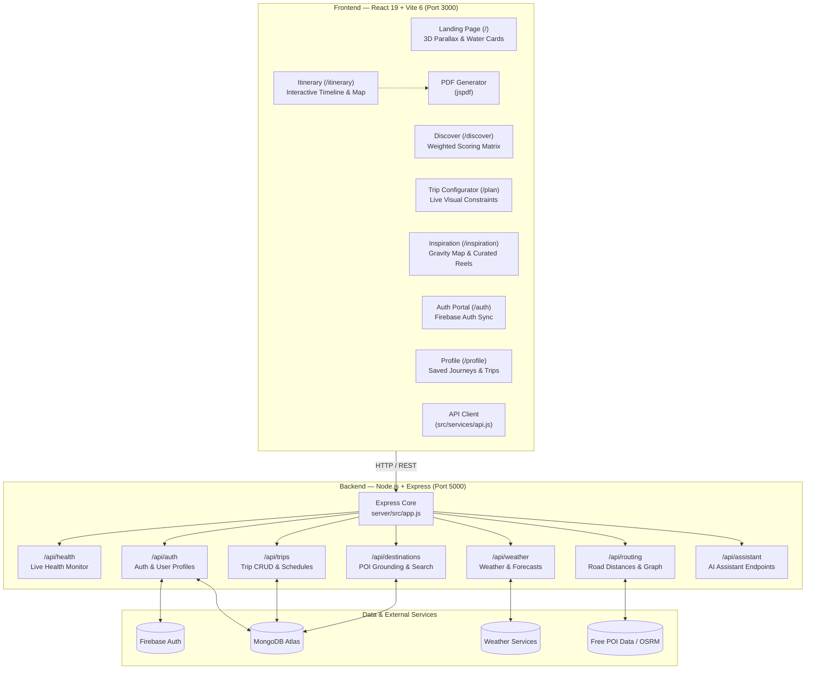

# 🌍 Dastaan | Crafting Your Travel Story

<div align="center">


### *Stories • Ideas • Emotions*

An immersive, editorial travel planning platform that unifies destination discovery, intelligent budgeting, topological routing, and cinematic day-by-day itineraries into a single personalized narrative.

[](https://react.dev/)
[](https://vitejs.dev/)
[](https://nodejs.org/)
[](https://expressjs.com/)
[](https://www.mongodb.com/)
[](https://firebase.google.com/)
[](LICENSE)

[Explore Features](#-key-features--user-journey) • [Architecture](#-technical-architecture) • [API Reference](#-api-reference) • [Quickstart](#-getting-started--local-development)

---

</div>

## 📖 Table of Contents
- [Executive Overview](#-executive-overview)
- [The Problem We Solve](#-the-problem-we-solve)
- [Key Features & User Journey](#-key-features--user-journey)
  - [1. Cinematic Storytelling Landing Experience](#1-cinematic-storytelling-landing-experience-)
  - [2. Intelligent Destination Discovery](#2-intelligent-destination-discovery-discover)
  - [3. Visual Trip Configurator](#3-visual-trip-configurator-plan)
  - [4. Dynamic Travel Journal & Itinerary](#4-dynamic-travel-journal--itinerary-itinerary)
  - [5. Editorial Inspiration & Thematic Orbits](#5-editorial-inspiration--thematic-orbits-inspiration)
  - [6. Conversational AI Travel Assistant](#6-conversational-ai-travel-assistant)
  - [7. Offline Journeys & Professional PDF Export](#7-offline-journeys--professional-pdf-export)
  - [8. User Profile & Account Management](#8-user-profile--account-management-profile)
- [Technical Architecture](#-technical-architecture)
- [Directory Structure](#-directory-structure)
- [Design System & Editorial Aesthetics](#-design-system--editorial-aesthetics)
- [Recommendation & Scoring Algorithm](#-recommendation--scoring-algorithm)
- [API Reference](#-api-reference)
- [Mongoose Data Models](#-mongoose-data-models)
- [Getting Started & Local Development](#-getting-started--local-development)
  - [1. Prerequisites](#1-prerequisites)
  - [2. Installation](#2-installation)
  - [3. Environment Variables](#3-environment-variables)
  - [4. Running the Platform](#4-running-the-platform)
  - [5. Automated Test Suites](#5-automated-test-suites)
- [Teammate & Contribution Guide](#-teammate--contribution-guide)
- [Roadmap](#-roadmap)

---

## 🧭 Executive Overview

**Dastaan** (*Urdu/Persian for "Tales" or "Epics"*) is an AI-assisted, full-stack travel intelligence application engineered to transform chaotic travel planning into an immersive editorial journal. 

Rather than forcing travelers to juggle disparate tools (booking sites, map tabs, recommendation blogs, spreadsheets, and notes), Dastaan unifies the entire planning journey:
- Recommends hand-tailored destinations using a multi-criteria scoring engine.
- Synthesizes realistic, route-optimized schedules taking real-world road networks, attractions, and operating hours into account.
- Allocates transparent budgets across stays, gastronomy, transport, and experiences.
- Provides real-time replanning via an integrated AI Travel Assistant and seamless PDF offline export.

---

## 🎯 The Problem We Solve

Traditional travel planning is highly fragmented:
* 🗺️ **Maps** for checking physical distances and routes
* 📝 **Blogs & Social Media** for curated recommendations
* 🏨 **Booking Engines** for accommodations and flights
* 📊 **Spreadsheets** for budget tracking and estimation
* 🗂️ **Notes Apps** for daily schedules and checklists

**Dastaan unifies this journey into a 3-step paradigm:**
1. **01 — Tell Us**: Input your destination, timeframe, budget limits, preferred pace, and interests.
2. **02 — We Plan**: Dastaan calculates realistic routes, cost breakdowns, and structured activity sequences.
3. **03 — You Travel**: Interact with an editorial day-by-day travel journal, modify items on the fly, chat with the AI assistant, or download an offline PDF guide.

---

## ✨ Key Features & User Journey

### 1. Cinematic Storytelling Landing Experience (`/`)
* **3D Scroll-Linked Parallax**: Layered architectural elements with Stari Most Bridge, mountain horizons, and dynamic sky transitions.
* **Layered Bridge Horizon**: The signature "DASTAAN" title rises from behind the stone bridge walkway, while the taglines and primary CTA are framed inside the arch opening.
* **Parametric Water-Cards**: 5 chapter cards emerge along an inverted trigonometric curve (`cos`/`sin`) with 3D perspective shifts.
* **Editorial Problem & Solution Showcase**: Interactive split comparison showing fragmented tools vs. Dastaan's unified workflow.
* **Live Replanning Simulation**: Demonstrates real-time constraint adaptation (e.g., dynamically adjusting costs from ₹30,000 to ₹19,600).

### 2. Intelligent Destination Discovery (`/discover`)
* **Progressive 4-Step Questionnaire**:
  * `01 TIME` — Duration (Weekend 2–3 days, 4–6 days, 6–7 days, or 8+ days).
  * `02 BUDGET` — Budget brackets (Under ₹10K, ₹10K–₹20K, ₹20K–₹40K, ₹40K+) or custom numeric amounts.
  * `03 EXPERIENCE` — Multi-select interests (*Food, Nature, Culture, History, Adventure, Shopping, Art, Nightlife*).
  * `04 PACE` — Travel rhythm (*Relaxed, Balanced, Packed*).
* **Scroll-Linked Progress Tracking**: Visual fill-bar and chapter highlighting powered by `IntersectionObserver`.
* **Cinematic Search Transition**: Progressive loader detailing search steps.
* **Asymmetric Editorial Results**: Match percentage ranking (*Great Fit, Strong Fit, Good Fit*), "Why it fits" rationales, sorting controls, and direct handoff to the trip configurator.

### 3. Visual Trip Configurator (`/plan`)
* **Dynamic Destination Picker**: Instant search and quick-select chips (*Amritsar, New Delhi, Jaipur, Manali, Kyoto, Mostar, Florence, Istanbul, etc.*).
* **Crossfading Backdrop Imagery**: Atmospheric photography changes dynamically with each chosen destination.
* **Stepper & Budget Controls**: Fine-grained duration adjustments with presets, custom budget inputs, and instant constraint validation.

### 4. Dynamic Travel Journal & Itinerary (`/itinerary`)
* **Full-Bleed Hero Header**: Cinematic destination imagery with customized taglines dynamically generated from user preferences.
* **"Trip at a Glance" Luxury Metric Cards**: Structured stats highlighting trip duration, budget tier, pace style, and live weather forecast cards (temperature, conditions, humidity, seasonal packing advice).
* **Day-by-Day Interactive Timeline**: Alternating editorial cards (*image-left / image-right*) with scheduled arrival times, categories, descriptions, addresses, and operating hours.
* **Inline Itinerary Editing**: Add custom activities, edit timings, drag/reorder items, and remove activities with real-time recalculation.
* **Topological SVG Route Canvas**: Path diagram visualizing travel sequences, estimated distance in kilometers, and estimated transit times.
* **Categorical Budget Breakdown**: Interactive visual progress bar displaying costs across Stays (40%), Food (25%), Transport (15%), Activities (15%), and Buffer (5%).
* **"Built Around You" Context Panels**: Narrative breakdown explaining how each selected interest influenced the journey.

### 5. Editorial Inspiration & Thematic Orbits (`/inspiration`)
* **De-Clustered Editorial Hero**: Champagne gold typography and warm ivory accents with pill CTA triggers.
* **Dastaan Thematic Orbits (Gravity Map)**: Interactive SVG node graph visualizing cultural soul connections between global destinations.
* **Floating Category Filter Dock**: Capsule chips for instant filtering (*All Collections, Weekend Escapes, Cultural Heritage, Royal Luxury, Spiritual Retreats, Wildlife & Nature*) paired with live search.
* **Journey Reel Modal**: Immersive full-screen editorial visual stories for featured spotlight destinations.

### 6. Conversational AI Travel Assistant
* **Context-Aware Dialogue**: Accessible across the itinerary to tweak pacing, suggest hidden gems, swap attractions, and answer local travel queries.
* **One-Click Itinerary Mutation**: Direct application of AI suggestions into your active itinerary without page reloads.

### 7. Offline Journeys & Professional PDF Export
* **Client-Side Vector PDF Engine**: Powered by `jspdf` to generate high-resolution, printable travel guides.
* **Complete Travel Pack**: Includes cover branding, summary metrics, day-by-day schedules with timings and operating hours, addresses, budget allocation tables, and running page numbers.

### 8. User Profile & Account Management (`/profile`)
* **Dual Auth Integration**: Firebase Authentication synchronized with MongoDB user profiles.
* **Saved Journeys & Bookmarks**: View, re-open, or delete saved itineraries and bookmarked destinations.
* **Capsule Navigation Dropdown**: Clean account capsule button (`[Avatar] User Name ▾`) providing fast access to Profile, Home, and Log out with outside-click dismissal.

---

## 🛠️ Technical Architecture



---

## 📁 Directory Structure

```text
Dastaan/
├── .env.example                        # Frontend environment variables template
├── .gitignore                          # Git ignore rules
├── index.html                          # Root HTML with typography fonts
├── package.json                        # Frontend dependencies & scripts
├── vite.config.js                      # Vite 6 configuration (Port 3000)
├── public/
│   ├── images/                         # Brand logos, destination photography
│   └── favicon.ico                     # App favicon
├── server/                             # === EXPRESS BACKEND ===
│   ├── .env.example                    # Backend environment template
│   ├── package.json                    # Backend dependencies & test scripts
│   ├── tests/                          # Automated Node.js test suites
│   └── src/
│       ├── app.js                      # Express middleware, CORS, route mounting
│       ├── server.js                   # Server entry point (Port 5000)
│       ├── config/
│       │   └── db.js                   # Mongoose connection & status tracking
│       ├── controllers/
│       │   ├── assistantController.js  # Conversational AI assistant logic
│       │   ├── authController.js       # Auth & profile sync
│       │   ├── destinationController.js# Destination catalog & saved bookmarks
│       │   ├── healthController.js     # Health check & database status
│       │   ├── routingController.js    # Distance matrix & topological order
│       │   ├── tripController.js       # Trip persistence & CRUD
│       │   └── weatherController.js    # Live forecast retrieval
│       ├── middleware/
│       │   ├── errorHandler.js         # Centralized error sanitization
│       │   └── notFound.js             # 404 handler for unknown endpoints
│       ├── models/
│       │   ├── User.js                 # User profile schema
│       │   ├── Trip.js                 # Trip and day itinerary schema
│       │   └── SavedDestination.js     # Saved bookmarks schema
│       └── routes/
│           ├── api.js                  # Master API router
│           ├── assistantRoutes.js      # /api/assistant routes
│           ├── authRoutes.js           # /api/auth routes
│           ├── destinationRoutes.js    # /api/destinations routes
│           ├── healthRoutes.js         # /api/health routes
│           ├── routingRoutes.js        # /api/routing routes
│           ├── tripRoutes.js           # /api/trips routes
│           └── weatherRoutes.js        # /api/weather routes
└── src/                                # === REACT FRONTEND ===
    ├── components/
    │   ├── AiAssistantModal.jsx        # Floating conversational AI assistant
    │   ├── Footer.jsx                  # Multi-column editorial footer
    │   ├── LightboxModal.jsx           # Full-screen destination photo modal
    │   ├── Navbar.jsx                  # Header with user account dropdown
    │   └── inspiration/
    │       ├── CategoryFilterBar.jsx   # Pill filters & search input
    │       ├── GravityMap.jsx          # SVG thematic orbit node diagram
    │       ├── JourneyReelModal.jsx    # Full-screen editorial visual modal
    │       └── StoryConstellation.jsx  # Destination cultural affinity matrix
    ├── data/
    │   ├── destinations.js             # Curated destinations catalog
    │   ├── inspirationData.js          # Inspiration reels & collections
    │   ├── interests.js                # Experience tags, descriptions, icons
    │   └── itineraries.js              # Seed itineraries with day activities
    ├── pages/
    │   ├── AuthPage.jsx                # Split-layout login/signup
    │   ├── DiscoverPage.jsx            # 4-step progressive questionnaire
    │   ├── ItineraryPage.jsx           # Dynamic travel journal & editor
    │   ├── LandingPage.jsx             # Parallax 3D storytelling
    │   ├── NotFoundPage.jsx            # Editorial 404 page
    │   ├── ProfilePage.jsx             # Saved trips & user settings
    │   ├── TripConfiguratorPage.jsx    # Interactive trip builder
    │   └── TripInspirationPage.jsx     # Curated collections & orbit map
    ├── services/
    │   ├── api.js                      # Axios/fetch API wrapper with retries
    │   ├── placesService.js            # POI fetching & routing coordinates
    │   └── weatherService.js           # Weather API integration
    ├── styles/                         # Modular CSS stylesheets
    │   ├── inspiration.css             # Inspiration page & gravity map styling
    │   ├── landing.css                 # 3D parallax scroll & water cards
    │   ├── navigation.css              # Header, footer & user dropdown styles
    │   ├── page3.css                   # Itinerary journal & glance cards
    │   └── ...
    ├── utils/
    │   ├── auth.js                     # Firebase auth helpers & storage sync
    │   ├── pdfExport.js                # jsPDF vector PDF export generator
    │   └── scoring.js                  # Weighted recommendation engine
    ├── App.jsx                         # Route declarations & top scroll
    ├── firebase.js                     # Firebase client configuration
    └── main.jsx                        # React 19 root mount
```

---

## 🎨 Design System & Editorial Aesthetics

Dastaan adheres to a disciplined editorial palette blending deep nature tones with warm parchment and champagne gold.

| Token | Hex Value | Role / Usage |
| :--- | :--- | :--- |
| **`--primary`** | `#173B35` / `#071D1A` | Deep Forest Green & Obsidian Emerald (Brand grounding) |
| **`--gold`** | `#DFBA73` | Royal Champagne Gold (Primary accent, active pills, borders) |
| **`--paper`** | `#F4EFE3` / `#E8DCC7` | Warm Ivory Paper (High-contrast typography, cards) |
| **`--bg-light`** | `#F7F5EF` | Editorial Cream (Day view backgrounds, questionnaires) |
| **`--ink`** | `#1D2421` | Charcoal Ink (Readable body copy) |
| **`--accent`** | `#C96B4B` / `#C87955` | Terracotta Clay (Route markers, badges, highlights) |

### Typography Hierarchy
* **Editorial Titles & Headings**: `Ogg Medium`, `Cormorant Garamond`, Georgia (Serif)
* **User Interface & Body Text**: `Inter`, `Satoshi`, system-ui (Sans-serif)

---

## 🧠 Recommendation & Scoring Algorithm

The Discover engine ranks destinations against traveler constraints using a multi-criteria scoring function ($S \in [10, 100]$):

$$\text{Total Score} = S_{\text{budget}} + S_{\text{duration}} + S_{\text{interests}} + S_{\text{pace}}$$

| Criterion | Max Weight | Logic & Evaluation |
| :--- | :---: | :--- |
| **Budget Fit** | **30%** | **30 pts** if estimated cost $\le$ user budget; **15 pts** if within $+25\%$ buffer; **5 pts** fallback. |
| **Duration Fit** | **25%** | **25 pts** if exact day match; **12 pts** if within $\pm 1$ day; **0 pts** outside range. |
| **Interests Match** | **30%** | $\text{Score} = \left(\frac{|\text{Matching Interests}|}{|\text{User Selected Interests}|}\right) \times 30\text{ pts}$. |
| **Pace Fit** | **15%** | **15 pts** if destination profile aligns with chosen rhythm (*Relaxed / Balanced / Packed*). |

---

## 🔌 API Reference

The backend Express application serves structured REST endpoints under the `/api` prefix.

### Health & Diagnostics
| Method | Endpoint | Description |
| :--- | :--- | :--- |
| `GET` | `/` | API status and root summary |
| `GET` | `/api/health` | Service uptime, MongoDB connectivity state, and environment |

### Authentication (`/api/auth`)
| Method | Endpoint | Description |
| :--- | :--- | :--- |
| `POST` | `/api/auth/register` | Register new user profile |
| `POST` | `/api/auth/login` | Authenticate existing user |
| `POST` | `/api/auth/sync` | Sync Firebase authenticated user with MongoDB record |
| `GET` | `/api/auth/me` | Fetch authenticated user profile details |

### Trip Management (`/api/trips`)
| Method | Endpoint | Description |
| :--- | :--- | :--- |
| `GET` | `/api/trips` | Retrieve user's saved trips |
| `POST` | `/api/trips` | Create and persist a new itinerary |
| `GET` | `/api/trips/:id` | Retrieve itinerary by ID |
| `PUT` | `/api/trips/:id` | Update customized itinerary activities |
| `DELETE` | `/api/trips/:id` | Remove saved trip |

### Destinations & Bookmarks (`/api/destinations`)
| Method | Endpoint | Description |
| :--- | :--- | :--- |
| `GET` | `/api/destinations` | Search and list curated destinations |
| `GET` | `/api/destinations/saved` | Fetch user's bookmarked destinations |
| `POST` | `/api/destinations/save` | Bookmark a destination |
| `DELETE` | `/api/destinations/save/:id` | Remove a bookmarked destination |

### Weather & Real-Time Intelligence (`/api/weather`)
| Method | Endpoint | Description |
| :--- | :--- | :--- |
| `GET` | `/api/weather/:destId` | Retrieve real-time weather and forecast data |

### Routing & Road Network (`/api/routing`)
| Method | Endpoint | Description |
| :--- | :--- | :--- |
| `POST` | `/api/routing/optimize` | Calculate geodesic distance matrix and optimal route order |

### AI Travel Assistant (`/api/assistant`)
| Method | Endpoint | Description |
| :--- | :--- | :--- |
| `POST` | `/api/assistant/chat` | Conversational query handling, itinerary adjustments, and suggestions |

---

## 🗄️ Mongoose Data Models

### 1. `User` (`server/src/models/User.js`)
* `name`: String (Required)
* `email`: String (Required, unique, trimmed, lowercase)
* `firebaseUid`: String (Unique index for Firebase Auth synchronization)
* `mobile`: String (Optional)
* `travelStyle`: String (Default: `'balanced'`)
* `timestamps`: Automatically manages `createdAt` and `updatedAt`

### 2. `Trip` (`server/src/models/Trip.js`)
* `userId`: String (Index, references user identifier)
* `destination`: Object containing `id`, `name`, `country`, `image`, `coordinates`
* `duration`: Number of days
* `budget`: Total estimated budget
* `interests`: Array of selected travel interest keys
* `travelStyle`: Preferred pace (*relaxed, balanced, packed*)
* `itinerary`: Object containing daily schedules, activity items, costs, and timings
* `timestamps`: Tracks creation and modification dates

### 3. `SavedDestination` (`server/src/models/SavedDestination.js`)
* `userId`: String (Indexed)
* `destinationId`: String
* `destinationName`: String
* `country`: String
* `compoundIndex`: `{ userId: 1, destinationId: 1 }` with `unique: true` to prevent duplicate bookmarks

---

## 🚀 Getting Started & Local Development

### 1. Prerequisites
- **Node.js**: v20+ recommended (tested on v20 and v22)
- **npm**: v10+
- **MongoDB**: MongoDB Atlas connection string or local MongoDB instance (`mongodb://localhost:27017/dastaan`)
- **Firebase Project** *(Optional for local preview, required for live Firebase Auth)*

### 2. Installation
Clone the repository and install dependencies for both the frontend and backend:

```bash
# 1. Clone repository
git clone https://github.com/NSharp-mahajan/Dastaan.git
cd Dastaan

# 2. Install frontend dependencies
npm install

# 3. Install backend dependencies
npm install --prefix server
```

### 3. Environment Variables

Create `.env` in the root directory:
```env
VITE_API_BASE_URL=http://localhost:5000/api
VITE_FIREBASE_API_KEY=your_firebase_api_key
VITE_FIREBASE_AUTH_DOMAIN=your_project.firebaseapp.com
VITE_FIREBASE_PROJECT_ID=your_project_id
VITE_FIREBASE_STORAGE_BUCKET=your_project.firebasestorage.app
VITE_FIREBASE_MESSAGING_SENDER_ID=your_messaging_id
VITE_FIREBASE_APP_ID=your_app_id
```

Create `server/.env` in the `server/` directory:
```env
PORT=5000
CLIENT_URL=http://localhost:3000
MONGODB_URI=your_mongodb_atlas_connection_string
NODE_ENV=development
```

### 4. Running the Platform

Run frontend and backend simultaneously using two terminals:

#### Terminal 1 — React Frontend (Port 3000)
```bash
npm run dev
```
> Application: **`http://localhost:3000`**

#### Terminal 2 — Express Server (Port 5000)
```bash
npm run server:dev
```
> API Server: **`http://localhost:5000`**  
> Health Check: **`http://localhost:5000/api/health`**

### 5. Automated Test Suites

The backend includes a comprehensive suite of integration and unit tests:

```bash
# Run all backend test suites
npm run test:all --prefix server

# Run optimizer and routing tests
npm run test:optimizer --prefix server
```

---

## 👥 Teammate & Contribution Guide

### Branching & Workflow
1. Pull the latest `main` branch before starting:
   ```bash
   git checkout main
   git pull --rebase origin main
   ```
2. Create your feature branch:
   ```bash
   git checkout -b feature/your-feature-name
   ```
3. Verify your changes build cleanly before committing:
   ```bash
   npm run build
   ```
4. Commit with descriptive semantic commit messages:
   ```bash
   git commit -m "feat(itinerary): add custom activity time recalculation"
   ```

---

## 🗺️ Roadmap

- [x] **Phase 1: Cinematic Planning Prototype** (HTML/CSS/JS Storytelling)
- [x] **Phase 2 — Frontend Architecture**: React 19 + Vite 6 + React Router 7 Migration
- [x] **Phase 2 — Backend & Database**: Express REST API + MongoDB Atlas + Mongoose Models
- [x] **Phase 2 — Auth & Profiles**: Dual Firebase Auth + MongoDB sync + Account Dropdown
- [x] **Phase 2 — Travel Intelligence**: Live weather integration, POI routing, and Discover scoring
- [x] **Phase 2 — Export & Offline**: High-resolution vector PDF itinerary generation
- [x] **Phase 2 — Conversational AI**: Dynamic assistant modal for live itinerary replanning
- [ ] **Phase 3 — Interactive Maps**: Mapbox / Vector GL map rendering with custom style layers
- [ ] **Phase 3 — Collaborative Planning**: Real-time multi-user shared trips via WebSockets

---

<div align="center">

<sub>Crafted with passion for authentic travel experiences • &copy; 2026 Dastaan. All rights reserved.</sub>

</div>
